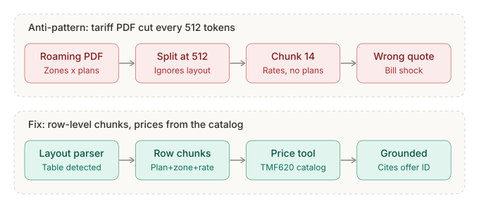
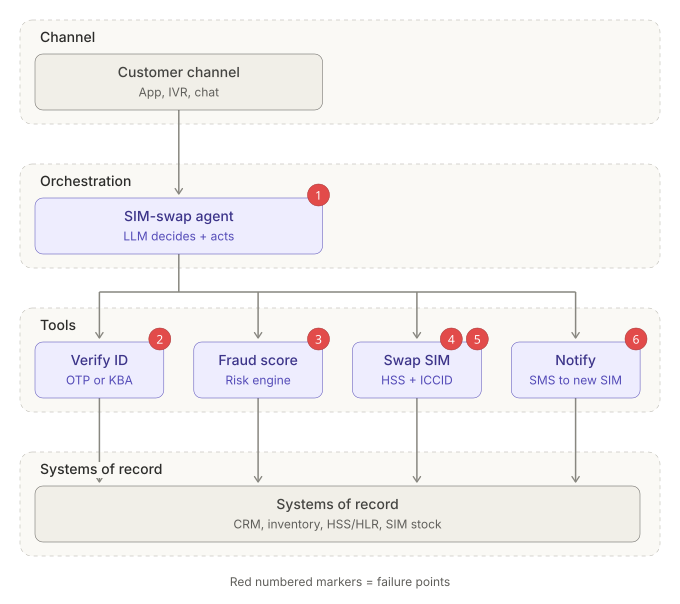
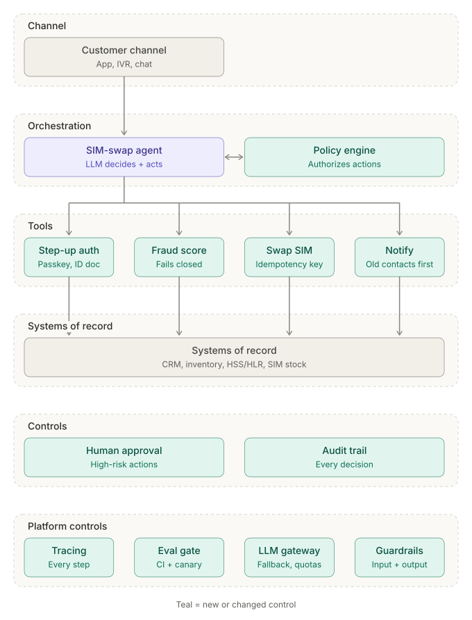

# AI Regensis Interview Prep

360 production failure scenarios for agentic AI, set in **Telco BSS** and **FinTech**, with
a Claude skill, an MCP server, a coach agent and a website to learn them. Plus
**Architecture Review**: describe an agentic system and get numbered failure points,
fixes linked to the scenarios, and before/after swimlane diagrams.

Every scenario answers the same questions an interviewer will ask: what happened, why it
breaks, where and how to fix it, how to detect it, what the fix costs, and the one line
that signals seniority.



## What's inside

| Part | Where | What it does |
| --- | --- | --- |
| Scenario catalog | `content/topics/*.yaml` | 18 topics x 20 scenarios (181 Telco BSS, 179 FinTech), each with analogy, diagram spec, fix, detection, trade-off, other-domain variant and interview line |
| Architecture Review | `src/antipatterns/review.py`, `content/rules.yaml` | 17 component and 5 platform rules, each linked to catalog scenarios; patches produce a fixed design |
| Reference architectures | `content/architectures/` | 10 designs: SIM swap, roaming care RAG, port-in, B2B order multi-agent, NOC diagnosis, card disputes, loan origination, AP invoices, AML triage, wealth copilot |
| Claude skill | `skill/agentic-ai-coach/` | Interview, explain and `/review-architecture` modes; self-contained, needs only PyYAML |
| MCP server | `mcp_server/server.py` | The same 12 tools for Claude Desktop, Claude Code or any MCP client |
| Coach agent | `src/antipatterns/agent.py`, `aap-coach` | Mock interviewer and Architecture Review on the Claude API |
| Website | `site/` | Browse, search, filter by domain, practice with self-grading, run reviews in the browser |

How the pieces fit: [docs/agent-architecture.md](docs/agent-architecture.md).

## Topics

| # | Topic | Scenario ids | Telco / FinTech |
| --- | --- | --- | --- |
| 1 | RAG | `rag-01` ... `rag-20` | 9 / 11 |
| 2 | LLM Evals | `eval-01` ... `eval-20` | 10 / 10 |
| 3 | Agent Frameworks | `agf-01` ... `agf-20` | 11 / 9 |
| 4 | Agent Evals | `aev-01` ... `aev-20` | 10 / 10 |
| 5 | Observability | `obs-01` ... `obs-20` | 10 / 10 |
| 6 | Telemetry | `tel-01` ... `tel-20` | 10 / 10 |
| 7 | Context Engineering | `ctx-01` ... `ctx-20` | 10 / 10 |
| 8 | Prompt Engineering | `prm-01` ... `prm-20` | 10 / 10 |
| 9 | MLOps / LLMOps | `ops-01` ... `ops-20` | 10 / 10 |
| 10 | CI/CD for Agentic AI | `cicd-01` ... `cicd-20` | 10 / 10 |
| 11 | Guardrails & AI Security | `sec-01` ... `sec-20` | 12 / 8 |
| 12 | Multi-Agent Systems | `mas-01` ... `mas-20` | 10 / 10 |
| 13 | Memory Management | `mem-01` ... `mem-20` | 8 / 12 |
| 14 | Tool Design & MCP | `tool-01` ... `tool-20` | 11 / 9 |
| 15 | Cost, Latency & Model Routing | `cost-01` ... `cost-20` | 9 / 11 |
| 16 | Human-in-the-Loop & Governance | `gov-01` ... `gov-20` | 10 / 10 |
| 17 | Fine-tuning vs RAG vs Prompting | `ft-01` ... `ft-20` | 10 / 10 |
| 18 | Data Pipelines & Governance for AI | `data-01` ... `data-20` | 11 / 9 |

## Architecture Review example: SIM-swap agent

`aap-coach review --arch telco-sim-swap-agent` finds six failure points: security policy only
in the prompt, weak identity verification, a fraud check that fails open, no human gate and a
non-idempotent swap, and a confirmation sent only to the new SIM, plus five platform gaps.

| As described | Fixed |
| --- | --- |
|  |  |

Write your own spec with [docs/architecture-spec.md](docs/architecture-spec.md), or let the
skill or agent write it from a plain-language description.

## Quick start

```bash
git clone https://github.com/AgenticForze/AI-Regensis-Interview-Prep.git
cd AI-Regensis-Interview-Prep
pip install -e ".[dev]"          # Python 3.10+

python scripts/validate.py       # catalog, rules and architectures
pytest -q                        # renderers, review engine, agent loop, MCP server
```

### Claude skill

```bash
python scripts/build_skill.py    # writes dist/agentic-ai-coach.zip
```

Upload `dist/agentic-ai-coach.zip` in Claude (Settings, Capabilities, Skills), or copy
`skill/agentic-ai-coach` into `~/.claude/skills/` for Claude Code. Then try:

- "Quiz me on agent evals, FinTech only."
- "Explain tool-05 with the diagram."
- "/review-architecture: our agent reads the AP inbox, matches invoices and pays suppliers through the bank API..."

### MCP server

Claude Desktop (`claude_desktop_config.json`) or Claude Code (`.mcp.json`):

```json
{
  "mcpServers": {
    "interview-prep": {
      "command": "python",
      "args": ["/path/to/AI-Regensis-Interview-Prep/mcp_server/server.py"]
    }
  }
}
```

Tools: `list_topics`, `search_scenarios`, `get_scenario`, `next_question`, `grading_rubric`,
`record_attempt`, `get_progress`, `list_reference_architectures`,
`get_reference_architecture`, `architecture_spec_guide`, `check_architecture_spec`,
`review_architecture`.

### Coach agent (CLI)

```bash
export ANTHROPIC_API_KEY=...                 # model: $AAP_MODEL, default claude-sonnet-5-5
aap-coach interview --user you --topic rag   # mock interview, graded on 5 criteria
aap-coach review --file my-system.txt        # LLM writes the spec, rules review it
aap-coach review --arch fintech-card-dispute-agent   # no API key needed
aap-coach review --spec my-spec.yaml                 # no API key needed
aap-coach progress --user you
```

Reviews write `report.md`, `before.svg`, `after.svg`, `spec.yaml` and `fixed-spec.yaml`.

### Website

```bash
python scripts/build_site.py     # site/dist/index.html, open it in a browser
```

The **Deploy website** workflow publishes it to GitHub Pages on every push to `main`.
Enable it once: Settings, Pages, Source: GitHub Actions.

## Adding a scenario

Add an entry to the topic's YAML in `content/topics/` with the fields used by the others
(`id`, `title`, `domain`, `severity`, `scenario`, `analogy`, `breaks`, `root_cause`, `where`,
`fix`, `detect`, `tradeoff`, `variant`, `line`, `related`, `diagram`). Keep diagram titles to
about 16 characters and subtitles to about 19, run `python scripts/validate.py`, then
`python scripts/build_skill.py` so the skill bundle stays in sync (CI checks it).

## Design notes

- One SVG renderer in Python and a line-for-line JavaScript port; tests require byte-identical
  output, so diagrams look the same in the repo, skill, agent and website.
- Review findings come from deterministic rules first; the agent's own extra risks are
  reported separately and labelled as model judgement.
- The coach grades with five binary criteria (anti-pattern, mechanism, concrete fix,
  detection, trade-off) instead of a 1-10 scale.
