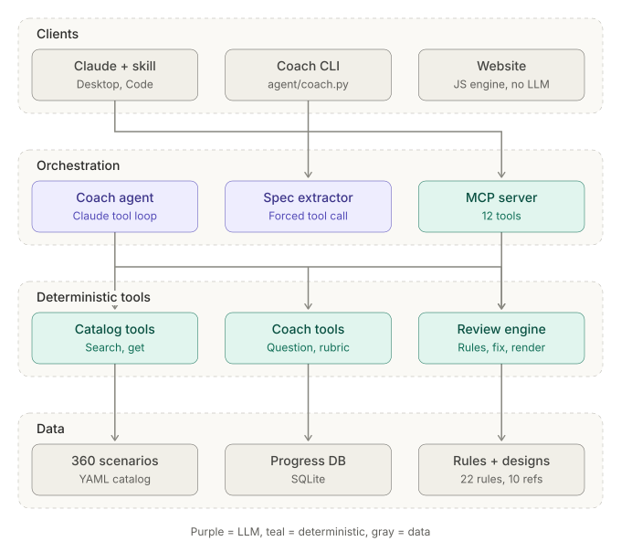

# Agent architecture

The coach is built the way the catalog says production agents should be built: the LLM
handles conversation, judgement and turning prose into structure; everything factual or
deterministic is a tool. The model never invents catalog content, rules or diagrams.



## Components

| Layer | Component | What it does |
| --- | --- | --- |
| Clients | Claude + skill | Claude Desktop or Claude Code with the `agentic-ai-coach` skill and/or the MCP server |
| | Coach CLI | `agent/coach.py` for interviews and reviews from a terminal |
| | Website | Static site; runs the JavaScript port of the review engine in the browser, no LLM |
| Orchestration | Coach agent | Claude Messages API tool loop (`src/antipatterns/agent.py`), capped at 12 steps |
| | Spec extractor | One forced `submit_spec` tool call that turns a scenario into an architecture spec, with validation and retry |
| | MCP server | `mcp_server/server.py` exposes the same 12 tools to any MCP client |
| Tools | Catalog tools | `list_topics`, `search_scenarios`, `get_scenario` |
| | Coach tools | `next_question`, `grading_rubric`, `record_attempt`, `get_progress` |
| | Review engine | `architecture_spec_guide`, `check_architecture_spec`, `review_architecture`, reference architectures |
| Data | Scenario catalog | `content/topics/*.yaml`, 18 topics x 20 scenarios |
| | Rules and designs | `content/rules.yaml` (17 component + 5 platform rules), `content/architectures/*.yaml` (10 designs) |
| | Progress DB | SQLite at `$AAP_PROGRESS_DB` (default `~/.aap/progress.db`) |

## Mode 1: mock interview

```
user ── "start" ──► Coach agent ── next_question ──► Coach tools ──► catalog (setup only)
user ◄── setup + question ──┘
user ── answer ──► Coach agent ── grading_rubric ──► 5 binary criteria + reference
                              judges each criterion true/false
                              ── record_attempt ──► Progress DB
user ◄── score, per-criterion feedback, reference fix, analogy, interview line
```

- `next_question` returns the setup only, so the answer can't leak into the question.
- Questions favour unanswered scenarios and, 60% of the time, the user's three weakest topics.
- Grading uses five **binary** criteria (names the anti-pattern, explains the mechanism,
  concrete fix in the right layer, detection, trade-off) rather than a 1-10 scale, following
  scenario eval-04. Equivalent fixes the reference doesn't list are accepted.

## Mode 2: Architecture Review

```
scenario text ──► Spec extractor (forced tool call)
                    ├─ critical fact unknown? ──► ONE clarifying question to the user
                    └─ spec ──► validate_spec ──errors──► back to the model (max 3 attempts)
spec ──► rule engine (deterministic) ──► numbered findings, each linked to catalog scenarios
     ──► patch engine ──► fixed spec ──► re-review must be clean (tested)
     ──► renderer ──► before.svg (red markers) + after.svg (teal controls)
findings ──► Coach agent (search_scenarios only) ──► up to 3 extra, scenario-specific risks
all ──► report.md
```

Catalog first, model second: the rule engine produces the numbered failure points so
results are consistent and traceable. The model's own additions go in a separate,
clearly labelled section. Anything new it finds is a candidate for a new rule.

## Safety and reliability choices

| Concern | Choice | Catalog reference |
| --- | --- | --- |
| Runaway loops | 12-step cap per turn, then a clear stop message | agf-02 |
| Tool errors | Returned to the model as structured, actionable text, never raised | agf-11 |
| Invalid structured output | Validated in code, errors fed back, 3 attempts max | eval-18 |
| Answer leakage | Question tool returns the setup only | eval-08 |
| Grading quality | Binary rubric criteria with a reference answer | eval-04, eval-03 |
| Hallucinated catalog content | All scenario text comes from tools | rag-10 |
| Determinism | Rules, fixes and diagrams are code; Python and JS outputs are parity-tested | cicd-03 |
| Model choice | `AAP_MODEL` environment variable, default `claude-sonnet-5-5` | ops-16 |

## Tests

`pytest` covers the renderers (byte-identical Python and JS SVG), the review engine
(parity on all reference architectures, fixed designs re-review clean, SIM-swap numbering),
the tools, the MCP server over stdio, and the agent loop with a scripted fake client
(tool execution, error feedback, spec retry, clarifying question, step cap). No API key is
needed to run the suite.
